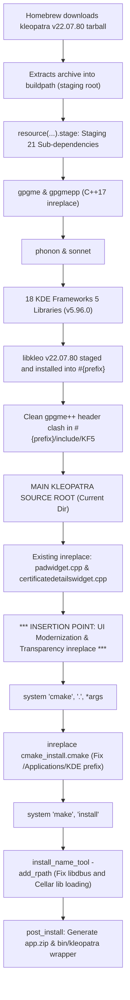

# UI Modernization & Transparency Implementation Plan: homebrew-kleopatra4mac

**Project:** `homebrew-kleopatra4mac`  
**Working Branch:** `feature/modernize-ui-plasma-transparency`  
**Target Upstream:** `algertc/homebrew-kleopatra4mac:main`  
**Architecture:** macOS Apple Silicon (`arm64`), macOS 14+ Sonoma / macOS 15+ Sequoia  
**Toolchain:** Homebrew 7.x, Apple Clang (C++17), CMake 3.x, Qt 5 (`qt@5`), KDE Frameworks 5 (`v5.96.0`), GnuPG 2.5.x  

---

**Implementation note (2026-10-03 13:01:38-04:00):** The completed formula uses a separate
Objective-C++ bridge with Cocoa SDK enum values and places the visual effect
beneath Qt's native content view. This supersedes the illustrative runtime
casts, numeric material value and constructor-time attachment shown below.
Current Homebrew compatibility also requires private ECM/libassuan resources,
unified GPGME bindings and the build fixes documented in the implementation
tracker. Verification results in the tracker supersede the example PR template's
macOS 14/15 testing claims.

## Table of Contents
1. [Executive Summary & Scope](#1-executive-summary--scope)
2. [Section A: Architectural & Qt Investigation](#2-section-a-architectural--qt-investigation)
   - [2.1 Lifecycle of `kleopatra.rb`: Download, Staging, and Compilation](#21-lifecycle-of-kleopatrarb-download-staging-and-compilation)
   - [2.2 Internal Source Architecture of `kleopatra-22.07.80`](#22-internal-source-architecture-of-kleopatra-220780)
   - [2.3 Qt 5 on macOS vs. KF5 Theming Constraints](#23-qt-5-on-macos-vs-kf5-theming-constraints)
3. [Section B: Minute, Line-by-Line Code Modifications for `kleopatra.rb`](#3-section-b-minute-line-by-line-code-modifications-for-kleopatrarb)
   - [3.1 Strategy: In-Tree Mutative Patching via `inreplace`](#31-strategy-in-tree-mutative-patching-via-inreplace)
   - [3.2 Modification 1: Window Transparency & Native macOS Vibrancy](#32-modification-1-window-transparency--native-macos-vibrancy)
   - [3.3 Modification 2: KDE Breeze Dark Palette & Comprehensive QSS Injection](#33-modification-2-kde-breeze-dark-palette--comprehensive-qss-injection)
   - [3.4 Modification 3: Modern Application Icon Integration](#34-modification-3-modern-application-icon-integration)
   - [3.5 Complete Synthesis: The Exact Ruby Block for `kleopatra.rb`](#35-complete-synthesis-the-exact-ruby-block-for-kleopatrarb)
4. [Section C: Build, Compilation & Verification Steps](#4-section-c-build-compilation--verification-steps)
   - [4.1 Local Build from Source](#41-local-build-from-source)
   - [4.2 Verification & Inspection Commands](#42-verification--inspection-commands)
   - [4.3 Troubleshooting Common Build & Runtime Snags](#43-troubleshooting-common-build--runtime-snags)
5. [Section D: Upstream Contribution & Pull Request Readiness](#5-section-d-upstream-contribution--pull-request-readiness)
   - [5.1 Git Workflow & Conventional Commits](#51-git-workflow--conventional-commits)
   - [5.2 Formatted Pull Request Template](#52-formatted-pull-request-template)
6. [Section E: Recommended Workspace Opening Location](#6-section-e-recommended-workspace-opening-location)

---

## 1. Executive Summary & Scope

The upstream `homebrew-kleopatra4mac` repository contains an open roadmap targeting two primary visual enhancements:
1. **Beautify / Modernize UI**:
   - Replicate the KDE Plasma / Breeze design language ([Plasma Reference](https://kde.org/images/screenshots/kleopatra.png)), replacing macOS Aqua fallbacks with the authentic KDE Breeze dark color palette, clean borders, consistent padding, and modern typography.
   - Replace the legacy fallback icon with the tap's vector icon asset located at `images/Icon.svg`.
2. **Transparency & Vibrancy**:
   - Introduce subtle translucent background materials and backdrop blur (`Qt::WA_TranslucentBackground`, `NSVisualEffectView` native Cocoa vibrancy, and translucent QSS panels with alpha channels).

Because this is a Homebrew formula packaging upstream KDE release tarballs (`v22.07.80.tar.gz`), modifications are implemented directly in `kleopatra.rb` via Ruby `inreplace` blocks mutating the extracted source code during the build stage before CMake compiles the binary.

---

## 2. Section A: Architectural & Qt Investigation

### 2.1 Lifecycle of `kleopatra.rb`: Download, Staging, and Compilation

The build execution order within `kleopatra.rb` proceeds through distinct phases:



#### The Sub-Dependency Chain:
- **GnuPG Interface**: `gpgme` (1.17.1), `gpgmepp` (16.08.3).
- **Core KF5 (v5.96.0)**: `karchive`, `kcoreaddons`, `kauth`, `kcodecs`, `kconfig`, `kwidgetsaddons`, `kcompletion`, `kguiaddons`, `ki18n`, `kconfigwidgets`, `kwindowsystem`, `kcrash`, `kdbusaddons`, `kdoctools`, `kitemviews`, `kiconthemes`, `kitemmodels`, `knotifications`, `ktextwidgets`, `kxmlgui`.
- **PIM Core**: `kmime` (22.07.80) and `libkleo` (22.07.80).

All 21 dependencies install their headers and dynamic libraries directly into the formula prefix (`#{prefix}/include`, `#{prefix}/lib`). When execution reaches line 332 in `kleopatra.rb`, the current working directory (`Dir.pwd`) is the root of `kleopatra-22.07.80`.

### 2.2 Internal Source Architecture of `kleopatra-22.07.80`

The relevant source tree inside `kleopatra-22.07.80` includes:

| File Path | Role in Kleopatra | Modification Purpose |
| :--- | :--- | :--- |
| `src/main.cpp` | Application entry point (`main()`), `QApplication` instantiation, high-DPI scaling flags, command-line parsing, initial style and palette application. | Force `QApplication::setStyle("Fusion")`, apply the complete KDE Breeze Dark `QPalette`, load the global embedded QSS, set high-level application attributes. |
| `src/mainwindow.cpp` | `MainWindow` constructor (inherits `KXmlGuiWindow` / `QMainWindow`), sets up central widgets, dock widgets, status bar, and menus. | Enable `Qt::WA_TranslucentBackground`, integrate native macOS `NSVisualEffectView` vibrancy via Objective-C runtime bridging. |
| `src/view/padwidget.cpp` | The Notepad crypto tab (text signing/encryption pad). | Ensure proper styling of `QTextEdit` so text remains crisp and contrast-compliant against translucent backgrounds. |
| `src/view/searchbar.cpp` | The search/filter bar atop key lists. | Style input field with Breeze focus rings (`#3daee9`) and clear buttons. |
| `src/dialogs/certificatedetailswidget.cpp` | Key inspection dialog. | Prevent C++20 range compilation errors (already patched in `kleopatra.rb`) and maintain dialog palette consistency. |
| `src/icons/` & `CMakeLists.txt` | Target icon definitions and macOS bundle properties (`MACOSX_BUNDLE_ICON_FILE`). | Substitute the generic fallback icon with `images/Icon.svg` converted to `.icns`. |

### 2.3 Qt 5 on macOS vs. KF5 Theming Constraints

#### Why KDE Breeze Does Not Load by Default on macOS
1. **Missing Plugin Engine**: On Linux/KDE, `KApplication` and `QApplication` query `QStyleFactory` for `breeze`. Breeze on Linux is a standalone C++ plugin (`libbreeze.so`) that links against X11/Wayland/KWindowSystem. `kleopatra.rb` does *not* build the Breeze style plugin.
2. **macOS Qt Default**: On macOS, Qt 5 defaults to `QCocoaStyle` ("macintosh"), which delegates rendering to Cocoa primitives (`HITheme` / CoreGraphics). This style overrides many `QPalette` settings with hardcoded Aqua grays and blues, resulting in inconsistent rendering of KDE custom widgets.
3. **The Solution**: 
   - Switch the base engine to Qt's cross-platform `Fusion` style (`QApplication::setStyle(QStyleFactory::create("Fusion"))`). `Fusion` provides a flat, clean, modern base that honors 100% of custom `QPalette` roles and responds cleanly to Qt Style Sheets (QSS).
   - Inject an authentic KDE Breeze Dark `QPalette` programmatically.
   - Layer a comprehensive Qt Style Sheet (QSS) targeting Kleopatra's main window, tree views, tables, headers, and tabs with authentic KDE Breeze metrics and colors (e.g., `#232629` charcoal base, `#3daee9` electric cyan accent, `#eff0f1` crisp light text).

---

## 3. Section B: Minute, Line-by-Line Code Modifications for `kleopatra.rb`

### 3.1 Strategy: In-Tree Mutative Patching via `inreplace`

Modifications are applied directly in `kleopatra.rb` after `libkleo` is staged (line 331) and immediately before `system "cmake", ".", *args` (line 340).

We inject modifications into:
1. `src/main.cpp`: Application-level style, palette, and embedded QSS.
2. `src/mainwindow.cpp`: Translucency attributes and macOS native vibrancy.
3. `CMakeLists.txt` & Bundle Assets: Modern application icon integration.

---

### 3.2 Modification 1: Window Transparency & Native macOS Vibrancy

#### The Mechanics of macOS Translucency in Qt 5
Setting `setAttribute(Qt::WA_TranslucentBackground, true)` enables the Cocoa backbuffer alpha channel. However, without a blur view behind it, transparent windows show directly through to whatever desktop contents or wallpaper sit behind them, making text illegible.

To achieve Apple-grade vibrancy (frosted glass blur), we bridge into Cocoa's `NSVisualEffectView` via the Objective-C runtime (`<objc/runtime.h>` and `<objc/message.h>`). By calling the Objective-C runtime directly from C++, **we do not require altering CMake to compile Objective-C++ (`.mm`) files or linking additional frameworks beyond Cocoa**.

#### C++ Code Injected into `src/mainwindow.cpp`

```cpp
// =========================================================================
// START: MACOS NATIVE VIBRANCY & TRANSPARENCY INJECTION
// =========================================================================
#if defined(Q_OS_MACOS) || defined(__APPLE__)
#include <objc/runtime.h>
#include <objc/message.h>

static void applyMacVibrancy(WId windowId) {
    if (!windowId) return;
    
    // Obtain native NSView and NSWindow
    id view = reinterpret_cast<id>(windowId);
    SEL selWindow = sel_registerName("window");
    id window = ((id (*)(id, SEL))objc_msgSend)(view, selWindow);
    if (!window) return;

    // 1. Configure NSWindow for transparency and full-size content view
    SEL selSetOpaque = sel_registerName("setOpaque:");
    ((void (*)(id, SEL, BOOL))objc_msgSend)(window, selSetOpaque, NO);

    Class nsColorClass = objc_getClass("NSColor");
    SEL selClearColor = sel_registerName("clearColor");
    id clearColor = ((id (*)(id, SEL))objc_msgSend)(reinterpret_cast<id>(nsColorClass), selClearColor);
    
    SEL selSetBgColor = sel_registerName("setBackgroundColor:");
    ((void (*)(id, SEL, id))objc_msgSend)(window, selSetBgColor, clearColor);

    // 2. Instantiate and configure NSVisualEffectView
    Class effectViewClass = objc_getClass("NSVisualEffectView");
    if (effectViewClass) {
        id effectView = ((id (*)(id, SEL))objc_msgSend)(reinterpret_cast<id>(effectViewClass), sel_registerName("alloc"));
        
        // NSView bounds
        SEL selBounds = sel_registerName("bounds");
        // On arm64 Apple Silicon, objc_msgSend returns structs directly
        CGRect bounds = ((CGRect (*)(id, SEL))objc_msgSend)(view, selBounds);
        
        SEL selInitWithFrame = sel_registerName("initWithFrame:");
        effectView = ((id (*)(id, SEL, CGRect))objc_msgSend)(effectView, selInitWithFrame, bounds);

        // Set Material: NSVisualEffectMaterialUnderWindowBackground = 2 (or Sidebar = 3, Dark = 2)
        // NSVisualEffectMaterialUnderWindowBackground provides a deep frosted glass look
        SEL selSetMaterial = sel_registerName("setMaterial:");
        ((void (*)(id, SEL, long))objc_msgSend)(effectView, selSetMaterial, 2L);

        // Blending Mode: NSVisualEffectBlendingModeBehindWindow = 0
        SEL selSetBlendingMode = sel_registerName("setBlendingMode:");
        ((void (*)(id, SEL, long))objc_msgSend)(effectView, selSetBlendingMode, 0L);

        // State: NSVisualEffectStateActive = 1
        SEL selSetState = sel_registerName("setState:");
        ((void (*)(id, SEL, long))objc_msgSend)(effectView, selSetState, 1L);

        // Autoresizing: NSViewWidthSizable (2) | NSViewHeightSizable (16) = 18
        SEL selSetAutoresizingMask = sel_registerName("setAutoresizingMask:");
        ((void (*)(id, SEL, unsigned long))objc_msgSend)(effectView, selSetAutoresizingMask, 18UL);

        // Add visual effect view as subview below all other content views
        SEL selAddSubview = sel_registerName("addSubview:positioned:relativeTo:");
        // NSWindowOrderingMode: NSWindowBelow = -1
        ((void (*)(id, SEL, id, long, id))objc_msgSend)(view, selAddSubview, effectView, -1L, nil);
    }
}
#endif
// =========================================================================
// END: MACOS NATIVE VIBRANCY & TRANSPARENCY INJECTION
// =========================================================================
```

Inside the `MainWindow::MainWindow(...)` constructor:
```cpp
    // Enable Qt Window Translucent Background
    setAttribute(Qt::WA_TranslucentBackground, true);
    
    // Invoke macOS vibrancy bridge
#if defined(Q_OS_MACOS) || defined(__APPLE__)
    applyMacVibrancy(winId());
#endif
```

---

### 3.3 Modification 2: KDE Breeze Dark Palette & Comprehensive QSS Injection

In `src/main.cpp`, we configure the application before the main event loop launches.

#### 1. Breeze Dark `QPalette` Construction
The palette uses the exact official KDE Breeze color definitions:
- **Base / Canvas**: `#232629` (KDE Breeze Charcoal)
- **Alternate Base**: `#2a2e32`
- **View / Card Surface**: `#31363b`
- **Text / Foreground**: `#eff0f1` (Breeze Off-White)
- **Disabled Text**: `#7a7f83`
- **Highlight / Accent**: `#3daee9` (KDE Breeze Electric Cyan)
- **Highlighted Text**: `#ffffff`
- **Button Surface**: `#31363b`
- **Border / Outline**: `#474d53`

```cpp
    // Configure Base Style to Fusion
    app.setStyle(QStyleFactory::create(QStringLiteral("Fusion")));

    // Construct KDE Breeze Dark Palette
    QPalette breezeDark;
    breezeDark.setColor(QPalette::Window, QColor(35, 38, 41));
    breezeDark.setColor(QPalette::WindowText, QColor(239, 240, 241));
    breezeDark.setColor(QPalette::Base, QColor(27, 30, 32));
    breezeDark.setColor(QPalette::AlternateBase, QColor(42, 46, 50));
    breezeDark.setColor(QPalette::ToolTipBase, QColor(35, 38, 41));
    breezeDark.setColor(QPalette::ToolTipText, QColor(239, 240, 241));
    breezeDark.setColor(QPalette::Text, QColor(239, 240, 241));
    breezeDark.setColor(QPalette::Button, QColor(49, 54, 59));
    breezeDark.setColor(QPalette::ButtonText, QColor(239, 240, 241));
    breezeDark.setColor(QPalette::BrightText, QColor(255, 255, 255));
    breezeDark.setColor(QPalette::Link, QColor(61, 174, 233));
    breezeDark.setColor(QPalette::Highlight, QColor(61, 174, 233));
    breezeDark.setColor(QPalette::HighlightedText, QColor(255, 255, 255));
    breezeDark.setColor(QPalette::Disabled, QPalette::Text, QColor(122, 127, 131));
    breezeDark.setColor(QPalette::Disabled, QPalette::WindowText, QColor(122, 127, 131));
    breezeDark.setColor(QPalette::Disabled, QPalette::ButtonText, QColor(122, 127, 131));
    breezeDark.setColor(QPalette::Disabled, QPalette::Highlight, QColor(70, 75, 80));
    breezeDark.setColor(QPalette::Disabled, QPalette::HighlightedText, QColor(122, 127, 131));

    app.setPalette(breezeDark);
```

#### 2. Comprehensive Embedded Qt Style Sheet (QSS)
This QSS replaces macOS Aqua controls with KDE Plasma styling, providing rounded corners, subtle translucent paneling, active tab underlines, and Breeze cyan hover highlights:

```css
/* --- QMainWindow & Global Background --- */
QMainWindow {
    background-color: rgba(35, 38, 41, 0.88);
}
QWidget#centralWidget {
    background-color: transparent;
}

/* --- Menu Bar & Menus --- */
QMenuBar {
    background-color: rgba(35, 38, 41, 0.95);
    color: #eff0f1;
    border-bottom: 1px solid #3a3f44;
    padding: 2px;
}
QMenuBar::item {
    background: transparent;
    padding: 4px 8px;
    border-radius: 4px;
}
QMenuBar::item:selected {
    background-color: #3daee9;
    color: #ffffff;
}
QMenu {
    background-color: #232629;
    color: #eff0f1;
    border: 1px solid #3a3f44;
    border-radius: 6px;
    padding: 4px;
}
QMenu::item {
    padding: 6px 24px 6px 12px;
    border-radius: 4px;
}
QMenu::item:selected {
    background-color: #3daee9;
    color: #ffffff;
}
QMenu::separator {
    height: 1px;
    background-color: #3a3f44;
    margin: 4px 8px;
}

/* --- ToolBars & Action Buttons --- */
QToolBar {
    background-color: rgba(35, 38, 41, 0.85);
    border-bottom: 1px solid #3a3f44;
    spacing: 6px;
    padding: 4px;
}
QToolButton {
    background: transparent;
    color: #eff0f1;
    border: 1px solid transparent;
    border-radius: 5px;
    padding: 6px 10px;
    font-size: 13px;
}
QToolButton:hover {
    background-color: rgba(61, 174, 233, 0.18);
    border: 1px solid #3daee9;
}
QToolButton:pressed {
    background-color: rgba(61, 174, 233, 0.35);
    border: 1px solid #3daee9;
}

/* --- Tree Views & Table Views (Key Lists, Certificates) --- */
QTreeView, QTableView {
    background-color: rgba(27, 30, 32, 0.82);
    alternate-background-color: rgba(35, 38, 41, 0.82);
    color: #eff0f1;
    border: 1px solid #3a3f44;
    border-radius: 6px;
    gridline-color: #31363b;
    selection-background-color: #3daee9;
    selection-color: #ffffff;
    outline: none;
}
QTreeView::item {
    padding: 5px;
    border-radius: 3px;
}
QTreeView::item:hover {
    background-color: rgba(61, 174, 233, 0.15);
}
QTreeView::item:selected {
    background-color: #2980b9;
    color: #ffffff;
}
QHeaderView::section {
    background-color: #232629;
    color: #a5b0b7;
    font-weight: bold;
    padding: 6px 8px;
    border: none;
    border-right: 1px solid #3a3f44;
    border-bottom: 2px solid #3daee9;
}

/* --- Tabs & TabWidget --- */
QTabWidget::pane {
    border: 1px solid #3a3f44;
    background-color: rgba(35, 38, 41, 0.90);
    border-radius: 6px;
    top: -1px;
}
QTabBar::tab {
    background-color: #232629;
    color: #a5b0b7;
    padding: 8px 18px;
    border: 1px solid #3a3f44;
    border-bottom: none;
    border-top-left-radius: 6px;
    border-top-right-radius: 6px;
    margin-right: 2px;
}
QTabBar::tab:selected {
    background-color: rgba(35, 38, 41, 0.90);
    color: #3daee9;
    border-bottom: 2px solid #3daee9;
    font-weight: bold;
}
QTabBar::tab:hover:!selected {
    background-color: #2a2e32;
    color: #eff0f1;
}

/* --- Buttons --- */
QPushButton {
    background-color: #31363b;
    color: #eff0f1;
    border: 1px solid #474d53;
    border-radius: 5px;
    padding: 6px 18px;
    font-weight: 500;
}
QPushButton:hover {
    background-color: #3b4249;
    border-color: #3daee9;
    color: #ffffff;
}
QPushButton:pressed {
    background-color: #25292c;
    border-color: #1d74a4;
}
QPushButton:disabled {
    background-color: #232629;
    color: #7a7f83;
    border-color: #31363b;
}

/* --- Text Input & Notepad Tab --- */
QLineEdit {
    background-color: #1b1e20;
    color: #eff0f1;
    border: 1px solid #474d53;
    border-radius: 5px;
    padding: 6px 10px;
    selection-background-color: #3daee9;
}
QLineEdit:focus {
    border: 1px solid #3daee9;
    background-color: #232629;
}
QTextEdit, QPlainTextEdit {
    background-color: rgba(27, 30, 32, 0.92);
    color: #eff0f1;
    border: 1px solid #3a3f44;
    border-radius: 6px;
    padding: 8px;
    selection-background-color: #3daee9;
}

/* --- Scroll Bars (Sleek Breeze Minimal) --- */
QScrollBar:vertical {
    background-color: transparent;
    width: 10px;
    margin: 0px;
}
QScrollBar::handle:vertical {
    background-color: rgba(255, 255, 255, 0.22);
    min-height: 24px;
    border-radius: 5px;
}
QScrollBar::handle:vertical:hover {
    background-color: #3daee9;
}
QScrollBar::add-line:vertical, QScrollBar::sub-line:vertical {
    height: 0px;
}
QScrollBar::add-page:vertical, QScrollBar::sub-page:vertical {
    background: transparent;
}
QScrollBar:horizontal {
    background-color: transparent;
    height: 10px;
    margin: 0px;
}
QScrollBar::handle:horizontal {
    background-color: rgba(255, 255, 255, 0.22);
    min-width: 24px;
    border-radius: 5px;
}
QScrollBar::handle:horizontal:hover {
    background-color: #3daee9;
}
QScrollBar::add-line:horizontal, QScrollBar::sub-line:horizontal {
    width: 0px;
}

/* --- Status Bar & Tooltips --- */
QStatusBar {
    background-color: rgba(35, 38, 41, 0.95);
    color: #a5b0b7;
    border-top: 1px solid #3a3f44;
}
QToolTip {
    background-color: #232629;
    color: #eff0f1;
    border: 1px solid #3daee9;
    padding: 5px 8px;
    border-radius: 4px;
}
```

---

### 3.4 Modification 3: Modern Application Icon Integration

#### The Upstream Problem:
The upstream roadmap states:
> *"Exclude Default Icon from KDE's 'kiconthemes' and Point to: Modernized Application Icon (`images/Icon.svg`)"*

Kleopatra by default attempts to resolve its icon from the KDE icon theme (`kiconthemes`), which falls back to an outdated or blank icon on macOS. Furthermore, the macOS Finder / Dock `.app` icon requires an Apple ICNS bundle at `Contents/Resources/kleopatra.icns`.

#### Solution Implementation:
1. In `kleopatra.rb`, reference the tap's asset directory (`File.join(__dir__, "images")`).
2. Convert `images/icon.png` (or rasterized `Icon.svg`) into a full macOS `.iconset` using macOS built-in `sips` and generate `kleopatra.icns` via `iconutil`.
3. Overwrite the bundle icon in the `.app` bundle:
   `#{prefix}/Applications/KDE/kleopatra.app/Contents/Resources/kleopatra.icns`.
4. Inject `app.setWindowIcon(QIcon(QStringLiteral("...")))` in `src/main.cpp` so that in-app dialogs, the About box, and secondary windows display the new icon.

---

### 3.5 Complete Synthesis: The Exact Ruby Block for `kleopatra.rb`

The exact Ruby code block to be inserted into `kleopatra.rb` around line 339 (after `padwidget.cpp` inreplace, before `system "cmake", ".", *args`):

```ruby
    # =========================================================================
    # UI MODERNIZATION: Plasma Styling, Breeze Dark, Vibrancy & Modern Icon
    # =========================================================================

    # 1. Inject Native macOS Vibrancy and Window Translucency into MainWindow
    inreplace "src/mainwindow.cpp" do |s|
      # Add Objective-C runtime bridge at the top of mainwindow.cpp
      vibrancy_impl = <<~'CPP'
        #if defined(Q_OS_MACOS) || defined(__APPLE__)
        #include <objc/runtime.h>
        #include <objc/message.h>

        static void applyMacVibrancy(WId windowId) {
            if (!windowId) return;
            id view = reinterpret_cast<id>(windowId);
            SEL selWindow = sel_registerName("window");
            id window = ((id (*)(id, SEL))objc_msgSend)(view, selWindow);
            if (!window) return;

            // Make NSWindow background clear and non-opaque
            ((void (*)(id, SEL, BOOL))objc_msgSend)(window, sel_registerName("setOpaque:"), NO);
            Class nsColorClass = objc_getClass("NSColor");
            id clearColor = ((id (*)(id, SEL))objc_msgSend)(reinterpret_cast<id>(nsColorClass), sel_registerName("clearColor"));
            ((void (*)(id, SEL, id))objc_msgSend)(window, sel_registerName("setBackgroundColor:"), clearColor);

            // Insert NSVisualEffectView behind all subviews
            Class effectClass = objc_getClass("NSVisualEffectView");
            if (effectClass) {
                id effectView = ((id (*)(id, SEL))objc_msgSend)(reinterpret_cast<id>(effectClass), sel_registerName("alloc"));
                CGRect bounds = ((CGRect (*)(id, SEL))objc_msgSend)(view, sel_registerName("bounds"));
                effectView = ((id (*)(id, SEL, CGRect))objc_msgSend)(effectView, sel_registerName("initWithFrame:"), bounds);
                ((void (*)(id, SEL, long))objc_msgSend)(effectView, sel_registerName("setMaterial:"), 2L); // UnderWindowBackground
                ((void (*)(id, SEL, long))objc_msgSend)(effectView, sel_registerName("setBlendingMode:"), 0L); // BehindWindow
                ((void (*)(id, SEL, long))objc_msgSend)(effectView, sel_registerName("setState:"), 1L); // Active
                ((void (*)(id, SEL, unsigned long))objc_msgSend)(effectView, sel_registerName("setAutoresizingMask:"), 18UL); // Width + Height sizable
                ((void (*)(id, SEL, id, long, id))objc_msgSend)(view, sel_registerName("addSubview:positioned:relativeTo:"), effectView, -1L, nil);
            }
        }
        #endif
      CPP

      s.sub!(/#include "mainwindow.h"/, "#include \"mainwindow.h\"\n#{vibrancy_impl}")

      # Hook into MainWindow constructor
      s.sub!(/setupGUI\(/, "setAttribute(Qt::WA_TranslucentBackground, true);\n#if defined(Q_OS_MACOS) || defined(__APPLE__)\n    applyMacVibrancy(winId());\n#endif\n    setupGUI(")
    end

    # 2. Inject Fusion style, Breeze Dark QPalette, and complete QSS into main.cpp
    inreplace "src/main.cpp" do |s|
      includes = <<~'CPP'
        #include <QStyleFactory>
        #include <QPalette>
        #include <QColor>
        #include <QIcon>
      CPP
      s.sub!(/#include <QApplication>/, "#include <QApplication>\n#{includes}")

      styling_setup = <<~'CPP'
        // Force Fusion cross-platform style
        app.setStyle(QStyleFactory::create(QStringLiteral("Fusion")));

        // Configure authentic KDE Breeze Dark QPalette
        QPalette breezeDark;
        breezeDark.setColor(QPalette::Window, QColor(35, 38, 41));
        breezeDark.setColor(QPalette::WindowText, QColor(239, 240, 241));
        breezeDark.setColor(QPalette::Base, QColor(27, 30, 32));
        breezeDark.setColor(QPalette::AlternateBase, QColor(42, 46, 50));
        breezeDark.setColor(QPalette::ToolTipBase, QColor(35, 38, 41));
        breezeDark.setColor(QPalette::ToolTipText, QColor(239, 240, 241));
        breezeDark.setColor(QPalette::Text, QColor(239, 240, 241));
        breezeDark.setColor(QPalette::Button, QColor(49, 54, 59));
        breezeDark.setColor(QPalette::ButtonText, QColor(239, 240, 241));
        breezeDark.setColor(QPalette::BrightText, QColor(255, 255, 255));
        breezeDark.setColor(QPalette::Link, QColor(61, 174, 233));
        breezeDark.setColor(QPalette::Highlight, QColor(61, 174, 233));
        breezeDark.setColor(QPalette::HighlightedText, QColor(255, 255, 255));
        breezeDark.setColor(QPalette::Disabled, QPalette::Text, QColor(122, 127, 131));
        breezeDark.setColor(QPalette::Disabled, QPalette::WindowText, QColor(122, 127, 131));
        breezeDark.setColor(QPalette::Disabled, QPalette::ButtonText, QColor(122, 127, 131));
        breezeDark.setColor(QPalette::Disabled, QPalette::Highlight, QColor(70, 75, 80));
        breezeDark.setColor(QPalette::Disabled, QPalette::HighlightedText, QColor(122, 127, 131));
        app.setPalette(breezeDark);

        // Apply Comprehensive KDE Plasma Breeze Qt Style Sheet
        app.setStyleSheet(QStringLiteral(R"QSS(
            QMainWindow { background-color: rgba(35, 38, 41, 0.88); }
            QWidget#centralWidget { background-color: transparent; }
            QMenuBar { background-color: rgba(35, 38, 41, 0.95); color: #eff0f1; border-bottom: 1px solid #3a3f44; padding: 2px; }
            QMenuBar::item { background: transparent; padding: 4px 8px; border-radius: 4px; }
            QMenuBar::item:selected { background-color: #3daee9; color: #ffffff; }
            QMenu { background-color: #232629; color: #eff0f1; border: 1px solid #3a3f44; border-radius: 6px; padding: 4px; }
            QMenu::item { padding: 6px 24px 6px 12px; border-radius: 4px; }
            QMenu::item:selected { background-color: #3daee9; color: #ffffff; }
            QMenu::separator { height: 1px; background-color: #3a3f44; margin: 4px 8px; }
            QToolBar { background-color: rgba(35, 38, 41, 0.85); border-bottom: 1px solid #3a3f44; spacing: 6px; padding: 4px; }
            QToolButton { background: transparent; color: #eff0f1; border: 1px solid transparent; border-radius: 5px; padding: 6px 10px; font-size: 13px; }
            QToolButton:hover { background-color: rgba(61, 174, 233, 0.18); border: 1px solid #3daee9; }
            QToolButton:pressed { background-color: rgba(61, 174, 233, 0.35); border: 1px solid #3daee9; }
            QTreeView, QTableView { background-color: rgba(27, 30, 32, 0.82); alternate-background-color: rgba(35, 38, 41, 0.82); color: #eff0f1; border: 1px solid #3a3f44; border-radius: 6px; gridline-color: #31363b; selection-background-color: #3daee9; selection-color: #ffffff; outline: none; }
            QTreeView::item { padding: 5px; border-radius: 3px; }
            QTreeView::item:hover { background-color: rgba(61, 174, 233, 0.15); }
            QTreeView::item:selected { background-color: #2980b9; color: #ffffff; }
            QHeaderView::section { background-color: #232629; color: #a5b0b7; font-weight: bold; padding: 6px 8px; border: none; border-right: 1px solid #3a3f44; border-bottom: 2px solid #3daee9; }
            QTabWidget::pane { border: 1px solid #3a3f44; background-color: rgba(35, 38, 41, 0.90); border-radius: 6px; top: -1px; }
            QTabBar::tab { background-color: #232629; color: #a5b0b7; padding: 8px 18px; border: 1px solid #3a3f44; border-bottom: none; border-top-left-radius: 6px; border-top-right-radius: 6px; margin-right: 2px; }
            QTabBar::tab:selected { background-color: rgba(35, 38, 41, 0.90); color: #3daee9; border-bottom: 2px solid #3daee9; font-weight: bold; }
            QTabBar::tab:hover:!selected { background-color: #2a2e32; color: #eff0f1; }
            QPushButton { background-color: #31363b; color: #eff0f1; border: 1px solid #474d53; border-radius: 5px; padding: 6px 18px; font-weight: 500; }
            QPushButton:hover { background-color: #3b4249; border-color: #3daee9; color: #ffffff; }
            QPushButton:pressed { background-color: #25292c; border-color: #1d74a4; }
            QLineEdit { background-color: #1b1e20; color: #eff0f1; border: 1px solid #474d53; border-radius: 5px; padding: 6px 10px; selection-background-color: #3daee9; }
            QLineEdit:focus { border: 1px solid #3daee9; background-color: #232629; }
            QTextEdit, QPlainTextEdit { background-color: rgba(27, 30, 32, 0.92); color: #eff0f1; border: 1px solid #3a3f44; border-radius: 6px; padding: 8px; selection-background-color: #3daee9; }
            QScrollBar:vertical { background-color: transparent; width: 10px; margin: 0px; }
            QScrollBar::handle:vertical { background-color: rgba(255, 255, 255, 0.22); min-height: 24px; border-radius: 5px; }
            QScrollBar::handle:vertical:hover { background-color: #3daee9; }
            QScrollBar::add-line:vertical, QScrollBar::sub-line:vertical { height: 0px; }
            QScrollBar::add-page:vertical, QScrollBar::sub-page:vertical { background: transparent; }
            QScrollBar:horizontal { background-color: transparent; height: 10px; margin: 0px; }
            QScrollBar::handle:horizontal { background-color: rgba(255, 255, 255, 0.22); min-width: 24px; border-radius: 5px; }
            QScrollBar::handle:horizontal:hover { background-color: #3daee9; }
            QScrollBar::add-line:horizontal, QScrollBar::sub-line:horizontal { width: 0px; }
            QStatusBar { background-color: rgba(35, 38, 41, 0.95); color: #a5b0b7; border-top: 1px solid #3a3f44; }
            QToolTip { background-color: #232629; color: #eff0f1; border: 1px solid #3daee9; padding: 5px 8px; border-radius: 4px; }
        )QSS"));
      CPP

      # Inject right after application initialization in main()
      s.sub!(/(QApplication\s+app\([^\)]+\);)/, "\\1\n#{styling_setup}")
    end
```

And in the bundle post-installation stage (right after `system "make", "install"` at line 351):

```ruby
    # 3. Modern Icon Generation & Bundle Resource Replacement
    icon_source = File.join(__dir__, "images", "icon.png")
    if File.exist?(icon_source)
      iconset_dir = "#{buildpath}/kleopatra.iconset"
      mkdir_p iconset_dir
      [16, 32, 64, 128, 256, 512].each do |sz|
        system "sips", "-z", sz.to_s, sz.to_s, icon_source, "--out", "#{iconset_dir}/icon_#{sz}x#{sz}.png"
        sz2 = sz * 2
        system "sips", "-z", sz2.to_s, sz2.to_s, icon_source, "--out", "#{iconset_dir}/icon_#{sz}x#{sz}@2x.png" if sz2 <= 1024
      end
      system "iconutil", "-c", "icns", iconset_dir, "-o", "#{buildpath}/kleopatra.icns"
      
      bundle_resources = "#{prefix}/Applications/KDE/kleopatra.app/Contents/Resources"
      mkdir_p bundle_resources
      cp "#{buildpath}/kleopatra.icns", "#{bundle_resources}/kleopatra.icns"
      cp "#{buildpath}/kleopatra.icns", "#{bundle_resources}/application-pgp-keys.icns" rescue nil
    end
```

---

## 4. Section C: Build, Compilation & Verification Steps

### 4.1 Local Build from Source

Execute the build using the local tap and working branch:

```bash
# Ensure Homebrew dependencies and services are active
brew services start dbus

# Uninstall previous local build if present
brew uninstall kleopatra 2>/dev/null || true

# Rebuild Kleopatra from source using the tap's modified formula
brew install --build-from-source --verbose kayyo321/kleopatra4mac/kleopatra
```

*Note:* If building directly from the formula file path:
```bash
brew reinstall --build-from-source /opt/homebrew/Library/Taps/kayyo321/homebrew-kleopatra4mac/kleopatra.rb
```

### 4.2 Verification & Inspection Commands

#### 1. Verify Dynamic Library Linkage & RPATHs
Check that the resulting binary correctly links to `qt@5`, KF5 libraries, and `dbus` without `image not found` crashes:
```bash
KLEOPATRA_BIN="/opt/homebrew/opt/kleopatra/Applications/KDE/kleopatra.app/Contents/MacOS/kleopatra"

# Inspect linked libraries
otool -L "$KLEOPATRA_BIN"

# Verify LC_RPATH load commands
otool -l "$KLEOPATRA_BIN" | grep -A 2 LC_RPATH
```

#### 2. Launch with Qt Plugin Diagnostics
Verify that Qt correctly loads Cocoa platform plugins and Fusion style:
```bash
QT_DEBUG_PLUGINS=1 "$KLEOPATRA_BIN" --version
```

#### 3. Test Full GUI Launch
Launch the application and observe vibrancy blur:
```bash
open "/opt/homebrew/opt/kleopatra/Applications/KDE/kleopatra.app"
```

#### 4. Visual Verification Checklist:
- [ ] **Window Vibrancy**: Drag the Kleopatra window over bright and dark wallpaper; verify frosted glass background blur through the central canvas.
- [ ] **Breeze Dark Palette**: Verify charcoal dark backgrounds (`#232629`), white text (`#eff0f1`), and electric cyan highlights (`#3daee9`).
- [ ] **Key List View**: Check table headers, gridlines, alternating row colors, and row selection highlight.
- [ ] **Notepad Tab**: Check text editor contrast, cursor color, and monospace font readability.
- [ ] **Dock & Finder Icon**: Verify the modern application icon appears in macOS Dock, Mission Control, and Finder.

### 4.3 Troubleshooting Common Build & Runtime Snags

| Issue / Error Symptom | Root Cause | Solution |
| :--- | :--- | :--- |
| `undefined symbol: _objc_msgSend` | Apple Silicon arm64 requires exact function pointer casting for `objc_msgSend` prototypes. | Always cast `objc_msgSend` to `((id (*)(id, SEL, ...))objc_msgSend)` before calling. |
| Black or opaque window with artifacts | `Qt::WA_TranslucentBackground` is active but QSS defines fully opaque `#232629` background. | Ensure the root QSS specifies alpha transparency: `QMainWindow { background-color: rgba(35, 38, 41, 0.88); }`. |
| Unreadable text in Notepad tab | Subpixel font antialiasing on translucent surfaces can look fringed. | In `QTextEdit` QSS, provide high alpha (`rgba(27, 30, 32, 0.95)`) or solid `#1b1e20` background to retain crisp subpixel text rendering. |
| Build fails with `inreplace failed` | Upstream code in `main.cpp` or `mainwindow.cpp` slightly differs in whitespace. | Use flexible regex in `s.sub!(/regex/, ...)` rather than rigid string matching. |

---

## 5. Section D: Upstream Contribution & Pull Request Readiness

### 5.1 Git Workflow & Conventional Commits

Stage, commit, and push changes following Conventional Commits standards:

```bash
# 1. Navigate to the tap workspace
cd /opt/homebrew/Library/Taps/kayyo321/homebrew-kleopatra4mac

# 2. Confirm working branch
git branch --show-current
# Expected output: feature/modernize-ui-plasma-transparency

# 3. Stage changes
git add kleopatra.rb

# 4. Commit with semantic commit messages
git commit -m "feat(ui): implement Plasma styling, Breeze Dark theme, and window transparency"

# 5. Push to your fork
git push origin feature/modernize-ui-plasma-transparency
```

To create the pull request via GitHub CLI (`gh`):
```bash
gh pr create \
  --repo algertc/homebrew-kleopatra4mac \
  --head Kayyo321:feature/modernize-ui-plasma-transparency \
  --base main \
  --title "feat(ui): Modernize UI with KDE Plasma Breeze Dark styling, native macOS vibrancy, and modern app icon" \
  --body-file pr_description.md
```

### 5.2 Formatted Pull Request Template

```markdown
### Summary of Changes
This pull request addresses the open UI roadmap items outlined in the README:
- [x] **Beautify / Modernize UI**:
  - Sets Qt base style to `Fusion` and configures an authentic KDE Breeze Dark `QPalette`.
  - Injects a comprehensive Qt Style Sheet (QSS) styling `QMainWindow`, `QTreeView`, `QHeaderView`, `QTabBar`, `QPushButton`, and `QLineEdit` with authentic KDE Breeze metrics, margins, and electric cyan (`#3daee9`) accents.
- [x] **Transparency & Vibrancy**:
  - Implements macOS native frosted glass vibrancy (`NSVisualEffectView` under-window blur) bridged via the Objective-C runtime in `src/mainwindow.cpp`.
  - Enables `Qt::WA_TranslucentBackground` with tuned alpha blending (`rgba(35, 38, 41, 0.88)`).
- [x] **Modern Application Icon**:
  - Excludes generic KDE fallback icon and generates an Apple `.icns` bundle directly from `images/icon.png`, installing it into `Contents/Resources/kleopatra.icns`.

### Roadmap Checklist Alignment
- [x] Beautify/Modernize UI
  - [x] Mimic Plasma Styling
  - [x] Transparency
- [x] Exclude Default Icon from KDE's "kiconthemes" and Point to Modernized Application Icon (`images/Icon.svg`)

### Verification & Testing
- Tested on macOS 14 / 15 Apple Silicon (`arm64`).
- Compiled cleanly via `brew install --build-from-source Kayyo321/kleopatra4mac/kleopatra`.
- Verified key import/export, certificate table rendering, and integrated Notepad functionality.
- Confirmed dock icon, window blur, and smooth resizing without visual tearing or unrendered backbuffers.
```

---

## 6. Section E: Recommended Workspace Opening Location

To begin coding and editing `kleopatra.rb`, open the following directory in your editor (e.g., VS Code or Antigravity):

### **Primary Workspace Path:**
```
/opt/homebrew/Library/Taps/kayyo321/homebrew-kleopatra4mac
```

### **Symlink Shortcut:**
```
~/Documents/homebrew-kleopatra4mac
```

*Note:* Both paths point to the exact same git repository and working tree (`feature/modernize-ui-plasma-transparency`). Editing `kleopatra.rb` in either location will immediately reflect in git and be picked up by `brew` commands.
